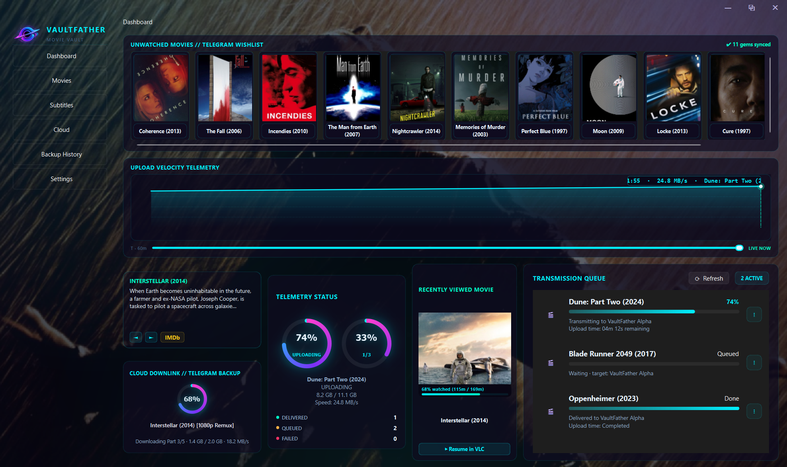
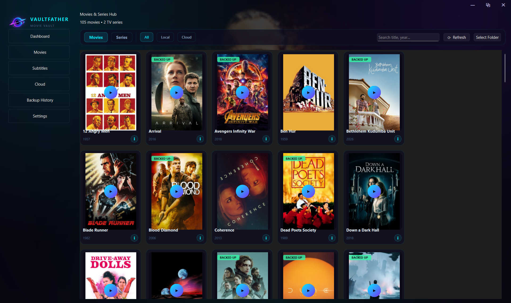
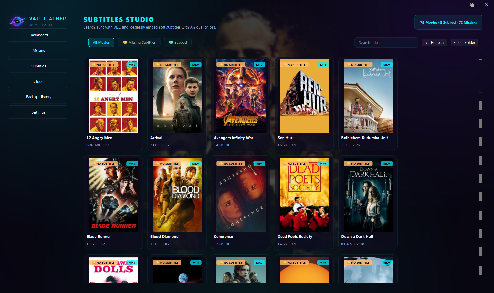
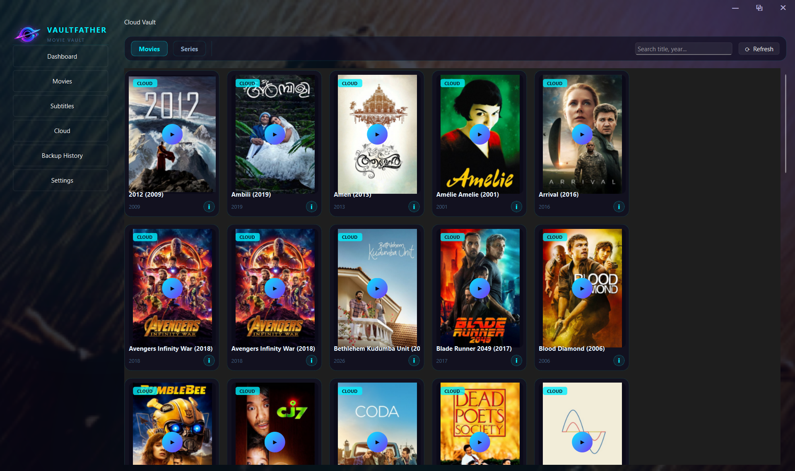
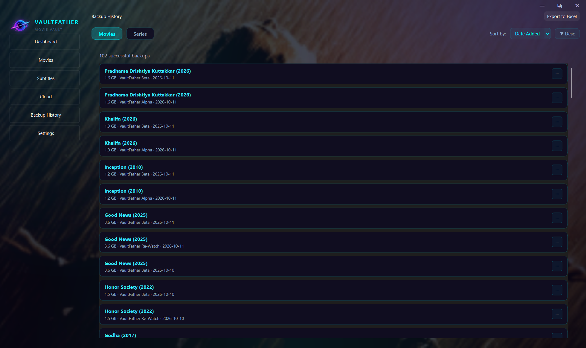
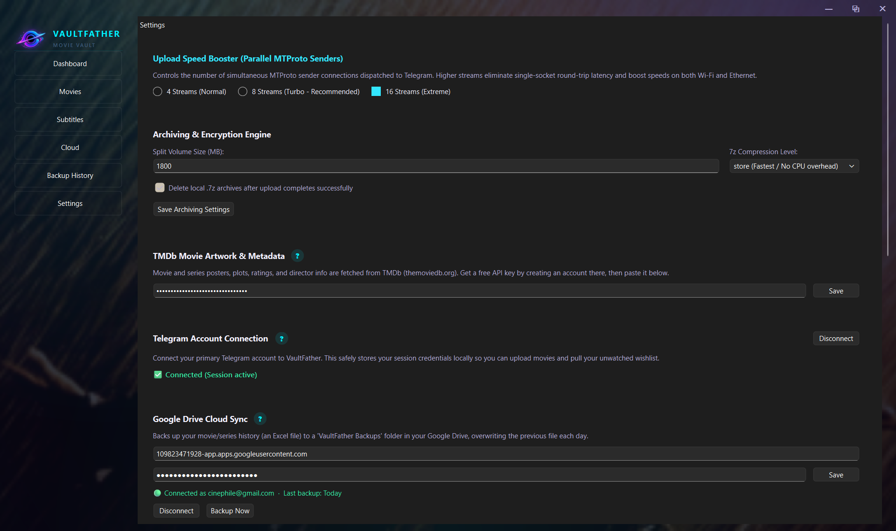

<div align="center">

# 🎬 VaultFather
### A Spacecraft-Deck Movie Hub with Lossless Subtitle Remuxing & Encrypted Telegram Cloud Storage

[](https://www.python.org/)
[](https://wiki.qt.io/Qt_for_Python)
[](https://github.com/LonamiWebs/Telethon)
[](https://www.7-zip.org/)
[](LICENSE)

*Built by a cinephile who got tired of running out of disk space, losing subtitles, and paying monthly fees for cloud storage.*

---

</div>

## 💡 Why did I build this?

If you collect high-bitrate 1080p and 4K movies, you know the drill:
1. **Local storage fills up fast.** Buying new hard drives or paying \$15–\$25/month for Google Drive / Dropbox gets old quick.
2. **Subtitles are a constant headache.** You grab a release, the dialogue is out of sync by 1.5 seconds, or you have to hunt down matching `.srt` files on shady sites full of popups.
3. **Most local media managers feel like bloated spreadsheets.** I wanted something that looks like the cockpit of an interstellar spacecraft with live cinematic 4K backdrops and instant playback.

**VaultFather solves this:**
- Turns **Telegram** into an **unlimited, private, encrypted cloud backup**.
- Encrypts your files locally with **7-Zip AES-256** and splits them into custom chunks (e.g. 1.8 GB volumes) so Telegram only ever sees generic encrypted binary data.
- Automatically hashes your video files to find **exact-match subtitles on OpenSubtitles**, lets you preview them, and **losslessly remuxes them (`-c copy`) in 2 seconds with 0% video/audio quality loss**.
- Free up local disk space without worry — your movies stay in the **Cloud Vault** tab and can be streamed or re-downloaded anytime with one click.

---

## 📸 Screenshots

<div align="center">

### 🛸 Cinema Command Dashboard
*Rotating 4K movie backdrops from TMDb Top 100 every 7 seconds, synopsis spotlight, and real-time upload telemetry stock chart.*


<br/><br/>

### 🎥 Movies & TV Series Hub
*Cyber Obsidian Glass cards, watch progress tracking, TV season groupings, and smart cut/edition cleaners.*


<br/><br/>

### 💬 Subtitles Studio
*64-bit video hash matching from OpenSubtitles, side-by-side VLC preview, and 0% quality loss stream-copy remuxing.*


<br/><br/>

### ☁️ Cloud Vault & Instant Restore
*Browse movies archived in your Telegram cloud. Stream or re-download with automatic multi-part archive re-assembly.*


<br/><br/>

### 📜 Backup History & Excel Export
*Complete audit trail with file hashes, part counts, upload speeds, and 1-click formatted Excel (.xlsx) export.*


<br/><br/>

### ⚙️ Command Settings
*Unified configuration for Telegram MTProto, TMDb poster artwork, and Google Drive daily backups.*


</div>

---

## ⚡ What does it actually do?

### 1. Zero Quality Loss Subtitle Remuxing (0% Degradation)
When you match a subtitle, VaultFather does **not** re-encode your video. It uses stream-copying (`ffmpeg -c copy`), meaning your video and audio streams are copied bit-for-bit.
- **Processing Time:** ~2 to 5 seconds per full-length movie.
- **Quality Loss:** **0.00%**. Not a single frame is recompressed.
- **Format Support:** Works seamlessly with `.mkv` and `.mp4`.
- **Archive Preservation:** Automatically bundles companion `.srt` files into the archive queue so you never lose subtitle metadata when restoring from the cloud.

### 2. Video Players: Bring Your Own, But VLC Is King
- **Any media player works:** VaultFather will open your videos in whatever default media player you have set on Windows (MPC-HC, MPV, PotPlayer, Movies & TV, etc.).
- **Why VLC is preferred:** If you have [VLC Media Player](https://www.videolan.org/vlc/) installed, the Subtitles Studio gains superpowers — it loads multiple candidate subtitle files simultaneously (`--sub-file` and `--input-slave`) so you can right-click inside VLC and hot-switch between candidate tracks in real time to verify lip sync before remuxing.

### 3. Encrypted Multi-Part Cloud Backups
- Splits large movies into customizable chunks (e.g. 1.8 GB volumes to fit Telegram's free 2 GB per-file ceiling).
- Applies randomized 7-Zip AES-256 encryption. To Telegram, your files look like random binary chunks (`movie.7z.001`, `movie.7z.002`).
- Multi-threaded MTProto parallel chunk uploading (up to 16 parallel streams) with automatic retry safeguards.
- Back up to multiple private channels (e.g., Primary Vault, 4K Archive, Unwatched Wishlist).
- Optional automated secondary backup to Google Drive.

### 4. Smart Library & Cut Cleaner
- Automatically handles messy release file names, channel tags (e.g., `@CC_Links.`), and special edition markers (`Director's Cut`, `Snyder Cut`, `The Final Cut`, `Extended Edition`).
- Matches the clean title to TMDb to pull official posters, plots, and metadata without breaking.

---

## 🛠️ Prerequisites & Download Links

You only need three free tools on your machine:

| Software | Why it's needed | Download Link |
|---|---|---|
| **Python 3.10+** | Runs the application *(Check "Add Python to PATH" during install!)* | [python.org/downloads](https://www.python.org/downloads/) |
| **VLC Player** | Recommended player for multi-subtitle live previewing | [videolan.org/vlc](https://www.videolan.org/vlc/) |
| **7-Zip** | High-speed encrypted movie splitting & archiving | [7-zip.org](https://www.7-zip.org/download.html) |
| **FFmpeg** *(Optional)* | Enables 2-second lossless subtitle remuxing (`winget install Gyan.FFmpeg`) | [ffmpeg.org](https://ffmpeg.org/download.html) |

---

## 🚀 Quick Start (1 Click on Windows)

1. Clone or download this repo:
   ```bash
   git clone https://github.com//aadhilmubarak/VaultFather.git
   cd VaultFather
   ```
2. Double-click **`run_vaultfather.bat`**.
3. That's literally it! The batch script will auto-detect Python, install all required dependencies from `requirements.txt` on first run, and launch the command center.

*(Or run manually via terminal: `pip install -r requirements.txt` then `python main.py`)*

---

## 🔑 How to Get Free API Keys (3 Minutes)

VaultFather costs \$0 to run, but needs two free keys to communicate with Telegram and TMDb:

### 1. Telegram API (`api_id` & `api_hash`)
1. Log in to [my.telegram.org](https://my.telegram.org) with your phone number.
2. Click **API development tools**.
3. Create an application (App title: `VaultFather`, Short name: `vaultfather`, Platform: `Desktop`).
4. Copy your `api_id` (a number) and `api_hash` (a string).
5. Open VaultFather → **Settings** tab → **Connect Telegram Account** → paste them in and authenticate.

### 2. The Movie Database (TMDb) API Key
1. Sign up for a free account at [themoviedb.org](https://www.themoviedb.org/).
2. Head to **Settings** → **API** → **Request an API Key** (choose Developer).
3. Fill in the brief form (App Name: `VaultFather`).
4. Copy your **API Key (v3 auth)** into VaultFather's **Settings** tab under TMDb Key.
5. All movie posters and live rotating 4K backdrops will unlock instantly.

---

## 🔒 Security & Privacy

- **Zero Telemetry / Zero Cloud Leakage:** All configuration files, database records, and session tokens are stored strictly on your local PC in `~/.vaultfather/`. VaultFather has no tracking, no analytics, and no third-party telemetry servers.
- **Client-Side AES-256:** Your movie files are encrypted locally *before* they touch the network. Even if someone gained access to your Telegram channel, they cannot open or view your archives without the encryption key.

---

## 💬 Frequently Asked Questions (FAQ)

**Q: Can I use MPC-HC / MPV / PotPlayer instead of VLC?**  
A: Yes! VaultFather will launch whatever default media player is configured in Windows. VLC is simply recommended for subtitle testing because it allows loading multiple subtitle tracks at once via CLI flags.

**Q: Will Telegram ban my account for uploading movies?**  
A: VaultFather splits and encrypts files into `.7z.001`, `.7z.002` volumes with randomized AES-256 passwords before uploading. Telegram servers see them as generic binary archives, not playable media files.

**Q: What happens if an upload fails mid-way?**  
A: VaultFather includes chunk-level retry safeguards and exponential backoff. If your connection drops, it will safely retry without corrupting the archive.

**Q: Does it work on Python 3.14+?**  
A: Yes! VaultFather is built with standard Python and modern PySide6 / Qt6 bindings.

---

## 📄 License

Distributed under the MIT License. See [LICENSE](LICENSE) for details.
